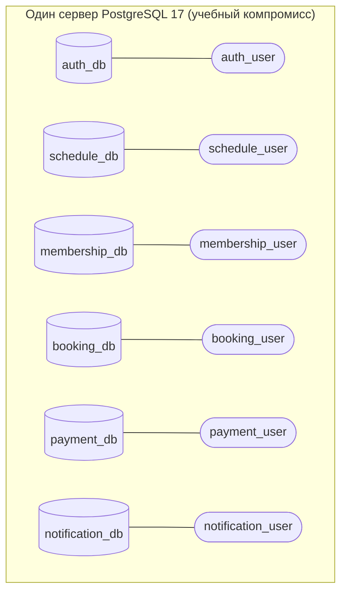

# Архитектура FitClub

## Назначение

FitClub — учебное микросервисное backend-приложение фитнес-клуба. Оно управляет пользователями и ролями, расписанием групповых тренировок, абонементами, бронированиями, тестовыми платежами и внутренними уведомлениями. Для демонстрации есть небольшой веб-интерфейс, он работает через тот же публичный REST API.

## Компоненты

Бизнес-сервисов **шесть**. Gateway, UI (Nginx), PostgreSQL, RabbitMQ и bootstrap-контейнеры в это число не входят: это инфраструктура, бизнес-правил в ней нет.

```mermaid
flowchart LR
    Browser["Браузер<br/>(UI в памяти вкладки)"] -->|HTTP /| Nginx["frontend<br/>Nginx, статика"]
    Nginx -->|/api/*| GW["gateway<br/>Spring Cloud Gateway"]

    GW -->|/api/auth, /api/admin/users| AUTH[auth-service]
    GW -->|/api/training-types, /api/sessions| SCH[schedule-service]
    GW -->|/api/plans, /api/membership-orders, /api/memberships| MEM[membership-service]
    GW -->|/api/payments| PAY[payment-service]
    GW -->|/api/bookings, /api/availability, /api/sessions/&#123;id&#125;/bookings| BOOK[booking-service]
    GW -->|/api/notifications| NOTE[notification-service]

    SCH -. "REST /internal: trainer-status" .-> AUTH
    PAY -. "REST /internal: payment-details" .-> MEM
    BOOK -. "REST /internal: eligibility" .-> MEM

    subgraph MQ["RabbitMQ: exchange fitclub.events (topic)"]
        Q1[[booking-service.events]]
        Q2[[membership-service.events]]
        Q3[[notification-service.events]]
    end

    SCH -- "SessionPublished / SessionCancelled (outbox)" --> Q1
    PAY -- "PaymentSucceeded / PaymentDeclined (outbox)" --> Q2
    MEM -- "MembershipActivated (outbox)" --> Q3
    BOOK -- "BookingConfirmed / BookingCancelled (outbox)" --> Q3
    Q1 --> BOOK
    Q2 --> MEM
    Q3 --> NOTE

    AUTH --- DB1[(auth_db)]
    SCH --- DB2[(schedule_db)]
    MEM --- DB3[(membership_db)]
    BOOK --- DB4[(booking_db)]
    PAY --- DB5[(payment_db)]
    NOTE --- DB6[(notification_db)]
```

Сплошные стрелки от Gateway — публичные HTTP-маршруты. Пунктир — внутренние HTTP-вызовы с `X-Service-Token`, Gateway их не публикует. Стрелки к очередям — асинхронные события через transactional outbox.

## Границы сервисов и владение данными

| Сервис | Ответственность | Владеет данными (таблицы) | Не делает |
|---|---|---|---|
| **auth-service** | Учётные записи, вход, access/refresh токены, роли, минимальный профиль (`display_name`) | `users`, `roles`, `user_roles`, `refresh_tokens` | Не знает об абонементах и записях. Других сервисов не вызывает |
| **schedule-service** | Типы тренировок, занятия, назначение тренера, публикация и отмена | `training_types`, `sessions`, `outbox_events` | Не считает занятые места. Не хранит бронирования |
| **membership-service** | Тарифы, заказы абонементов, активация, срок действия, право на посещение (eligibility) | `plans`, `membership_orders`, `memberships`, `outbox_events`, `processed_events` | Не списывает посещения. Не проводит оплату |
| **booking-service** | Запись на занятие, вместимость, отмена, учёт использованных посещений | `session_inventory`, `bookings`, `membership_usage`, `idempotency_records`, `outbox_events`, `processed_events` | Не меняет расписание и абонементы |
| **payment-service** | Платежи (симулятор), тестовое завершение, идемпотентность | `payments`, `idempotency_records`, `outbox_events` | Не активирует абонемент: только публикует результат оплаты |
| **notification-service** | Внутренние уведомления, прочтение, сохраняемые напоминания | `notifications`, `reminder_jobs`, `booking_projection`, `processed_events` | Не меняет данные других сервисов |

У membership-service тоже есть таблица `idempotency_records` для `POST /api/membership-orders`. Технические таблицы добавляются в БД того сервиса, которому они нужны.

### Почему границы проведены именно так

- **Лимит посещений считает Booking**, а не Membership. Списание посещения и занятие места — одна локальная транзакция в `booking_db`, поэтому распределённая транзакция при записи не нужна. Membership отвечает только на вопрос «действует ли право в момент T и какой у него лимит».
- **Вместимость задаёт Schedule, свободные места считает Booking.** `capacity` — неизменяемое условие опубликованного занятия, Booking получает его снимком из `SessionPublished`. Schedule не читает таблицы Booking.
- **Payment не трогает Membership.** Результат оплаты передаётся событием. Membership сам сверяет сумму, валюту и владельца заказа со своим снимком.
- **Отдельного User Service нет**: минимальный профиль (`display_name`) живёт в Auth, а шести сервисов с ясными границами достаточно.

### Межсервисные ссылки и снимки

- Межсервисные ссылки хранятся как UUID без внешних ключей, например `sessions.trainer_id` или `bookings.membership_id`.
- Чужие данные хранятся только как явно названные **снимки** или **проекции событий**, и редактировать их нельзя:
  - `sessions.trainer_display_name` — снимок имени тренера на момент назначения (Schedule ← Auth);
  - `membership_orders.plan_*` — неизменяемый снимок тарифа в заказе (внутри Membership);
  - `session_inventory` — проекция `SessionPublished`/`SessionCancelled` (Booking ← Schedule);
  - `booking_projection` — проекция состояния бронирования для напоминаний (Notification ← Booking).

## Изоляция хранения

- Bootstrap (`infrastructure/postgres/bootstrap-databases.sh`) создаёт роль `<service>_user` с владельцем `<service>_db` и делает `REVOKE ALL ON DATABASE ... FROM PUBLIC`. Подключиться к чужой БД роль не может, это проверяет `verify-isolation.sh`.
- Приложения не подключаются под `postgres`. Пароль `postgres` нужен только bootstrap-контейнеру.
- Таблицы создаёт Flyway сервиса под его собственной ролью.
- Запрещены SQL, JOIN и FK между БД разных сервисов. Технически это и невозможно: у роли нет `CONNECT` к чужой БД.
- **Компромисс.** Изоляция логическая. Один сервер экономит память учебного стенда, но остаётся общей точкой отказа: при его остановке недоступны все сервисы. Физической независимости хранилищ так не получить. Переход к отдельному серверу — это изменение `FITCLUB_DB_URL` одного сервиса, код не меняется (будет показано на этапе 2).

## Слои внутри сервиса

Внутри каждого сервиса используется разделение на слои, MVC применяется в части `api`:

| Пакет | Содержит | Может зависеть от |
|---|---|---|
| `api` | REST-контроллеры, request/response DTO, маппинг ошибок | `application` |
| `application` | Use case'ы (сценарии) и **порты**, которые им нужны (`MembershipEligibilityReader`, `EventPublisher`, `PaymentProvider` …) | `domain` |
| `domain` | Сущности, value objects, правила (`BookingPolicy` …). Без Spring Web, AMQP и JPA-репозиториев | — |
| `infrastructure` | JPA-адаптеры, HTTP-клиенты, AMQP, outbox, безопасность, конфигурация | `application`, `domain` |

Направление зависимостей проверяется ArchUnit-тестами. Подробнее о SOLID — в `docs/solid.md` (появится на этапах с реальным кодом).

Шесть контроллеров в одном приложении **не были бы** шестью микросервисами. Здесь каждый сервис — отдельный процесс со своей БД, конфигурацией и жизненным циклом, а общается с остальными только через HTTP и RabbitMQ.

## Сетевые адреса (план)

| Компонент | Порт в контейнере | Порт на машине |
|---|---|---|
| frontend (Nginx, шаг 10) | 80 | `8080` (публичный адрес UI) |
| gateway | 8080 | `127.0.0.1:8000` (API и общий Swagger UI) |
| auth / schedule / membership / booking / payment / notification | 8080 | dev-override: 8081…8086 |
| PostgreSQL | 5432 | `127.0.0.1:5432` |
| RabbitMQ AMQP / Management | 5672 / 15672 | `127.0.0.1:5672` / `127.0.0.1:15672` |

Внутри Compose сервисы обращаются друг к другу по именам контейнеров (`http://membership-service:8080`, `postgres:5432`). При запуске из IDE используется `localhost` и порты dev-override. Адреса задаются только конфигурацией.
