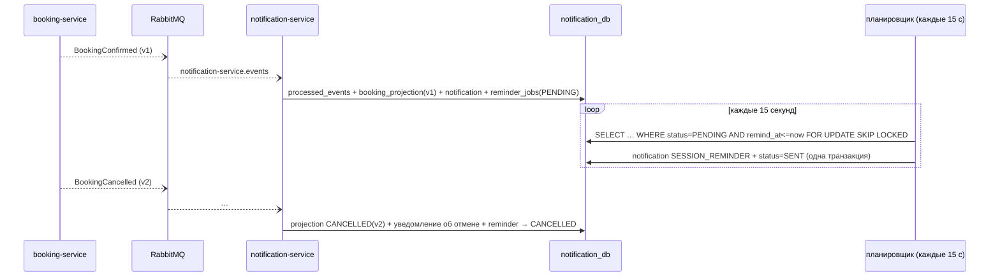

# Сценарии: REST, события и согласованность

> Статус: оплата и активация (шаг 7), запись и отмены (шаг 8), уведомления и напоминания (шаг 9) реализованы и проверены.

## Оплата и активация абонемента

```mermaid
sequenceDiagram
    autonumber
    actor C as Клиент (UI)
    participant GW as Gateway
    participant M as membership-service
    participant P as payment-service
    participant MQ as RabbitMQ
    participant N as notification-service

    C->>GW: POST /api/membership-orders {plan_id} + Idempotency-Key
    GW->>M: (JWT проверен)
    M-->>C: 201 заказ AWAITING_PAYMENT (цена — снимок тарифа)

    C->>GW: POST /api/payments {membership_order_id} + Idempotency-Key
    GW->>P: (JWT проверен)
    P->>M: GET /internal/membership-orders/{id}/payment-details (X-Service-Token, таймауты)
    M-->>P: user_id, status, amount_minor, currency
    P-->>C: 201 платёж PENDING (сумма с сервера, владелец сверен)

    C->>GW: POST /api/payments/{id}/simulate {SUCCESS} + Idempotency-Key  (только demo)
    P->>P: BEGIN; payments → SUCCEEDED; INSERT outbox PaymentSucceeded; COMMIT
    P-->>C: 200 SUCCEEDED
    Note over C: UI показывает «активация…» и опрашивает /api/memberships/me

    P--)MQ: relay: PaymentSucceeded (confirm + без возврата)
    MQ--)M: очередь membership-service.events
    M->>M: BEGIN; processed_events(event_id); проверка владельца, суммы, валюты;<br/>заказ → PAID; INSERT memberships; INSERT outbox MembershipActivated; COMMIT; ACK
    M--)MQ: relay: MembershipActivated
    MQ--)N: очередь notification-service.events (уведомление — шаг 9)
    C->>GW: GET /api/memberships/me
    M-->>C: ACTIVE, [starts_at = момент оплаты, ends_at = +30 дней)
```

### Где какая транзакция

| Шаг | Сервис | Что фиксируется вместе |
|---|---|---|
| Заказ | membership | заказ + запись `idempotency_records` (под блокировкой пользователя) |
| Платёж | payment | платёж `PENDING` + `idempotency_records`. Чтение реквизитов из Membership — **до** транзакции |
| Тестовое завершение | payment | статус платежа + событие в `outbox_events` + `idempotency_records` |
| Активация | membership | `processed_events` + заказ `PAID` + абонемент + `MembershipActivated` в outbox |

Общей распределённой транзакции нет. Payment и Membership согласуются через событие: **eventual consistency**. Между ответом «платёж SUCCEEDED» и появлением абонемента проходит обычно меньше секунды (в Docker-проверке абонемент был виден сразу).

### Что происходит при сбоях

| Сбой | Поведение |
|---|---|
| Membership недоступен при создании платежа | Платёж не создаётся: `503`/`504`. Придуманный «успешный» ответ невозможен |
| RabbitMQ недоступен после оплаты | Платёж `SUCCEEDED` уже сохранён, событие ждёт в outbox payment. После восстановления брокера relay его отправит. Пока событие не отправлено, абонемент не активирован. UI показывает «активация в процессе» |
| membership-service остановлен | `PaymentSucceeded` ждёт в durable-очереди `membership-service.events`. После запуска Membership обработает его |
| Повторная доставка `PaymentSucceeded` (тот же `event_id`) | `processed_events` → пропуск, второй абонемент не создаётся |
| Новое событие о том же платеже (другой `event_id`) | Заказ уже `PAID` с этим `payment_id` → `ALREADY_APPLIED`, срок не продлевается |
| Сумма/валюта/владелец не совпадают со снимком заказа | Абонемент не создаётся, сообщение уходит в `membership-service.events.dlq` для ручного разбора |
| Испорченное сообщение (не JSON) | Сразу в DLQ, очередь не блокируется: следующее событие обрабатывается |
| `PaymentDeclined` | Заказ `PAYMENT_FAILED`, абонемента нет, можно сделать новый заказ |
| `PaymentDeclined` пришёл после `PaymentSucceeded` | Игнорируется: заказ уже `PAID`, абонемент сохраняется |
| Повтор `POST /api/payments` с другим ключом | Возвращается тот же платёж: по заказу не больше одного платежа (`uq_payments_order`) |
| Повтор тестового завершения с тем же ключом | Тот же ответ, второго события нет |
| Попытка сменить `SUCCEEDED` на `DECLINED` | `409 PAYMENT_ALREADY_COMPLETED` |

Все строки таблицы, кроме остановки сервисов в Docker, проверены автотестами `PaymentApiIT`, `PaymentEventsIT` и `PaymentRulesTest`. Остановка Membership и брокера в сквозном сценарии — шаг 11.

## Запись на занятие

```mermaid
sequenceDiagram
    autonumber
    actor C as Клиент
    participant B as booking-service
    participant M as membership-service
    participant DB as booking_db
    participant MQ as RabbitMQ

    Note over B,MQ: заранее: SessionPublished → session_inventory (снимок, capacity, version)
    C->>B: POST /api/bookings {session_id} + Idempotency-Key
    B->>DB: (read-only) ключ уже выполнен? снимок занятия есть?
    B->>M: GET /internal/memberships/eligibility?user_id&at=starts_at (вне транзакции, таймаут)
    M-->>B: membership_id, visit_limit (или eligible=false)
    B->>DB: BEGIN
    B->>DB: SELECT … FROM session_inventory FOR UPDATE  (1)
    B->>DB: INSERT membership_usage ON CONFLICT DO NOTHING; SELECT … FOR UPDATE  (2)
    B->>B: BookingPolicy: открыто, не началось, абонемент есть, нет записи, есть место, есть посещение
    B->>DB: INSERT bookings; UPDATE booked_count+1; UPDATE used_count+1; INSERT outbox BookingConfirmed; INSERT idempotency
    B->>DB: COMMIT
    B-->>C: 201 CONFIRMED
    B--)MQ: relay: BookingConfirmed → notification-service
```

### Почему не «SELECT, потом INSERT»

Проверка «есть место» и увеличение `booked_count` выполняются под блокировкой строки `session_inventory`. Две параллельные записи на последнее место выстраиваются в очередь на этой строке, и вторая уже видит, что мест нет. То же для последнего посещения абонемента: оно защищено блокировкой строки `membership_usage`, даже если записи идут на разные занятия. Ограничения БД — последняя линия защиты:
- `booked_count <= capacity`;
- `used_count <= visit_limit`;
- одна `CONFIRMED`-запись на пару (занятие, пользователь).

### Порядок блокировок (защита от deadlock)

Во **всех** сценариях одинаковый порядок: строка занятия → строка учёта посещений → бронь.

| Сценарий | Блокировки |
|---|---|
| Запись | занятие → учёт посещений → новая бронь |
| Отмена пользователем | занятие → учёт посещений → бронь |
| Отмена занятия (`SessionCancelled`) | занятие → для каждой брони (по `membership_id`): учёт посещений → бронь |

Блокирующее чтение всегда перечитывает строку (`EntityManager.refresh(…, PESSIMISTIC_WRITE)`). Конкурентный тест показал: если бронь уже прочитана в транзакции без блокировки, `SELECT … FOR UPDATE` в Hibernate возвращает её **закэшированное** состояние. Из-за этого пользовательская отмена после отмены занятия создавала второе событие `BookingCancelled`.

### Проверено конкурентными тестами (`BookingIT.Concurrency`)

| Сценарий | Итог |
|---|---|
| 2 клиента на последнее место | ровно 1 запись, у второго `SESSION_FULL`, `booked_count = 1` |
| 10 клиентов на 3 места | ровно 3 записи и 7 отказов `SESSION_FULL` |
| 1 клиент, 2 занятия, осталось 1 посещение | ровно 1 запись, у второй `VISIT_LIMIT_REACHED`, `used_count = 1` |
| Отмена пользователем одновременно с `SessionCancelled` | место и посещение возвращены один раз, одно событие `BookingCancelled` |

## Отмена записи и отмена занятия

- **Пользователь** может отменить запись, если `now <= starts_at − CANCEL_BEFORE_MINUTES` (по умолчанию 120 минут, равенство разрешено). Тест проверяет обе стороны границы: ровно на границе можно, через секунду — `409 CANCELLATION_WINDOW_CLOSED`. Повторная отмена возвращает текущее состояние и ничего не возвращает второй раз.
- **Администратор** отменяет занятие в schedule-service, Booking получает `SessionCancelled`. Он закрывает запись и отменяет все `CONFIRMED`-брони с причиной `SESSION_CANCELLED`, независимо от пользовательского окна. Место и посещение возвращаются, по каждой брони публикуется `BookingCancelled`.
- **Согласованность eventual.** Пока `SessionCancelled` не доставлено, Booking считает занятие открытым и может принять запись. Когда событие придёт, эта запись тоже будет отменена с возвратом ресурса. Задержка не приводит к потере посещения.

### Порядок событий занятия

Booking применяет событие занятия, только если его `aggregate_version` **больше** уже применённой.

- `SessionCancelled` пришло раньше `SessionPublished` → создаётся «надгробие» `CANCELLED`, и опоздавшая публикация его не открывает.
- Повторное или старое `SessionPublished` после отмены игнорируется.
- Разрывы версий (например, v1 → v4 после правок черновика) допустимы: важна только монотонность, промежуточные версии не нужны, потому что каждое событие несёт полный снимок.

| Сбой | Поведение |
|---|---|
| Membership недоступен или медленный при записи | `503` / `504`, запись **не** разрешается по придуманному результату |
| `SessionPublished` ещё не доставлен | `409 SESSION_NOT_READY` («повторите через несколько секунд»), `GET /api/availability` → `state: NOT_READY` |
| booking-service был остановлен | События занятий ждут в очереди `booking-service.events` (в Docker-проверке событие, опубликованное на шаге 5, обработано при первом запуске booking) |
| Повтор `POST /api/bookings` со старым ключом после отмены | Тот же ответ `201` с тем же `id`, новой записи нет |

## Уведомления и напоминания



- **Доставка** через порт `NotificationChannel`. Реализация InApp сохраняет уведомление в `notifications` и отдаёт его через `GET /api/notifications`. Email или push можно добавить новым адаптером.
- **Задачи напоминаний** хранятся в БД и переживают перезапуск: в Docker задача осталась `PENDING` после `docker compose restart notification-service`. Двойной отправки нет, потому что задачи берутся `FOR UPDATE SKIP LOCKED` и меняют статус в той же транзакции.
- **Время.** Бизнес-логика получает `Clock` через конструктор, тесты переставляют часы и не ждут реального часа. В текстах время показывается в `Europe/Chisinau`.

| Сбой | Поведение (проверено в Docker) |
|---|---|
| notification-service остановлен | Запись на занятие проходит: Booking от Notification не зависит. `GET /api/notifications` через Gateway → `503 DEPENDENCY_UNAVAILABLE`. Событие ждёт в очереди |
| Notification снова запущен | Событие из очереди обработано, уведомление появилось (`unread` 3 → 4) |
| Повторная доставка события | Тот же `event_id` → пропуск. Тот же факт с новым `event_id` → дубль подавлен по `dedup_key` |
