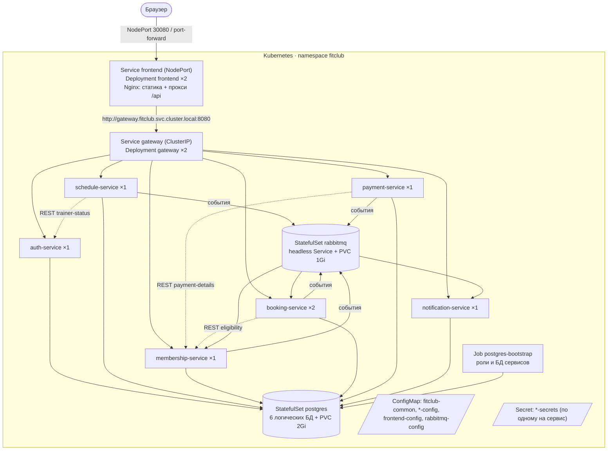

# FitClub — Лабораторная 3: Docker и Kubernetes

Приложение из [Лабораторной 2](../lab2/README.md) контейнеризировано и развёрнуто в Kubernetes (Minikube).
В кластере работают:
- шесть бизнес-сервисов;
- API Gateway;
- интерфейс на Nginx;
- PostgreSQL и RabbitMQ.

Конфигурация хранится в ConfigMap, секреты — в Secret. У каждого контейнера есть health checks и лимиты ресурсов.

> **Состояние: всё проверено 19.11.2026.**
> - **Minikube** (1.39, Kubernetes 1.37): развёртывание с нуля — 63 с, все 14 Pod'ов Ready без перезапусков.
> - **Через кластер:** demo-данные засеяны, E2E-тесты Лабы 2 — **6/6**.
> - **Масштабирование:** до 3 реплик за 16 с, 30 запросов распределились 9/10/11.
> - **Восстановление** после удаления Pod'а — 18 с.
> - **Docker Compose:** E2E-тесты на тех же образах — **9/9**.
>
> Результаты — в разделах 9 и 10.

## Содержание

1. [Описание проекта](#1-описание-проекта)
2. [Архитектура](#2-архитектура)
3. [Используемые технологии](#3-используемые-технологии)
4. [Установка](#4-установка)
5. [Запуск](#5-запуск)
6. [Configuration](#6-configuration)
7. [API](#7-api)
8. [Примеры использования (демонстрация)](#8-примеры-использования-демонстрация)
9. [Тестирование](#9-тестирование)
10. [Результаты экспериментов](#10-результаты-экспериментов)
11. [Выводы](#11-выводы)
- [Ответы на вопросы защиты](#ответы-на-вопросы-защиты)
- [Неисправности](#неисправности)

## Структура

```
lab3/
├── README.md                      этот файл
├── docker/
│   ├── README.md                  оптимизация образов, замеры, альтернативы
│   └── build-images.ps1 / .sh     сборка образов в Docker внутри Minikube (или загрузка готовых)
├── k8s/                           kubectl apply -R -f k8s/
│   ├── 00-namespace.yaml          namespace fitclub (00- — применяется первым)
│   ├── configmaps/                общая и посервисная конфигурация, Nginx, скрипт bootstrap БД, RabbitMQ
│   ├── secrets/                   README и пример структуры; сами Secret создаёт скрипт (в Git значений нет)
│   ├── infrastructure/            PostgreSQL и RabbitMQ (StatefulSet + headless Service), Job bootstrap БД
│   ├── deployments/               8 Deployment: 6 сервисов, gateway, frontend
│   └── services/                  8 Service: ClusterIP для сервисов и gateway, NodePort для frontend
├── demo/                          Job demo-seed и его скрипт (вне k8s/: данные — только по явной команде)
└── scripts/
    ├── create-secrets.ps1 / .sh   Secret из lab2/secrets (значения не выводятся)
    ├── deploy.ps1 / .sh           namespace → Secret → apply -R → ожидание готовности
    ├── sync-configmaps.ps1 / .sh  ConfigMap из файлов lab2/infrastructure (один источник для Compose и k8s)
    ├── demo-seed.ps1              наполнение demo-данными
    ├── demo-scaling.ps1           масштабирование и распределение запросов по Pod'ам
    ├── demo-recovery.ps1          удаление Pod и автоматическое восстановление
    └── test-k8s.ps1               E2E-тесты Лабы 2 через Gateway в кластере
```

Dockerfile'ы лежат рядом с кодом сервисов в `lab2/` (`services/*/Dockerfile`, `gateway/Dockerfile`, `frontend/Dockerfile`). Образ собирается из того же кода, что проверяют тесты, а Docker Compose и Kubernetes используют одни и те же образы.

## 1. Описание проекта

**FitClub** — система фитнес-клуба:
- клиенты покупают абонементы (тестовая оплата), записываются на групповые занятия и получают уведомления;
- тренеры видят участников своих занятий;
- администратор ведёт расписание, тарифы и роли.

Подробно о предметной области и бизнес-правилах — в [lab2/README.md](../lab2/README.md).

Цель Лабы 3 — пройти путь «код → оптимизированный образ → Docker Compose → Kubernetes» и показать возможности
оркестратора:
- декларативное развёртывание;
- обнаружение сервисов по DNS;
- конфигурацию и секреты вне образа;
- проверки здоровья;
- лимиты ресурсов;
- масштабирование и самовосстановление.

## 2. Архитектура



Каждый бизнес-сервис в кластере — это **Deployment** (Pod'ы) плюс **Service** типа ClusterIP: стабильное DNS-имя
`<service>:8080` и балансировка между готовыми Pod'ами. Сервисы обращаются друг к другу только по этим именам,
не через `localhost`. Адреса заданы в ConfigMap `fitclub-common`.

| Компонент | Объект | Реплик | Service | Порт | Пробы | requests → limits |
|---|---|---|---|---|---|---|
| auth, schedule, membership, payment, notification | Deployment | 1 | ClusterIP | 8080 | startup/liveness `/health`, readiness `/ready` | 100m/384Mi → 1 CPU/768Mi |
| booking-service | Deployment | **2** | ClusterIP | 8080 | то же | то же |
| gateway | Deployment | **2** | ClusterIP | 8080 | то же | 100m/256Mi → 1 CPU/512Mi |
| frontend | Deployment | **2** | **NodePort 30080** | 80 → 8080 | liveness/readiness `/nginx-health` | 20m/32Mi → 0.2 CPU/64Mi |
| postgres | StatefulSet + PVC 2Gi | 1 | headless | 5432 | `pg_isready` | 100m/256Mi → 1 CPU/512Mi |
| rabbitmq | StatefulSet + PVC 1Gi | 1 | headless | 5672, 15672 | `rabbitmq-diagnostics` | 100m/256Mi → 1 CPU/512Mi |
| postgres-bootstrap | Job | — | — | — | — | 10m/32Mi → 0.2 CPU/128Mi |
| wait-for-database | initContainer в каждом сервисе с БД | — | — | — | — | 10m/32Mi → 0.2 CPU/64Mi |

Порядок запуска без ручных пауз:
1. **PostgreSQL** стартует первым.
2. **Job `postgres-bootstrap`** ждёт его (`pg_isready`) и создаёт роли и БД.
3. **initContainer `wait-for-database`** каждого сервиса ждёт, пока под ролью сервиса откроется его БД. Только после этого запускается JVM и Flyway.
4. **`startupProbe`** даёт JVM до 3 минут на старт.
5. **`readinessProbe` (`/ready`)** включает Pod в Service, когда БД доступна и миграции применены.

## 3. Используемые технологии

| Технология | Зачем | Альтернативы и почему не они |
|---|---|---|
| Docker, многостадийные Dockerfile | Воспроизводимые образы без JDK, Maven и секретов | Подробно — [docker/README.md](docker/README.md) |
| Docker Compose | Быстрая локальная проверка всей системы одной командой, E2E-тесты | — (рекомендован заданием перед Kubernetes) |
| Kubernetes 1.37 через **Minikube 1.39** (драйвер docker, runtime containerd) | Один узел-кластер в Docker Desktop, встроенные NodePort, `minikube image`, addons (metrics-server) | **kind** — быстрее, но без `minikube service` и addons; **Docker Desktop Kubernetes** — нужно включать в настройках, задание называет Minikube; **k3d/k3s** — облегчённый дистрибутив, отличается от «обычного» Kubernetes |
| kubectl (из Docker Desktop) | Применение манифестов, логи, масштабирование | Helm — шаблонизация не нужна для одного окружения; Kustomize — можно (`kubectl kustomize` используется для проверки), но задание просит `kubectl apply -f k8s/` |
| Deployment | Stateless-сервисы: реплики, rolling update, самовосстановление | ReplicaSet напрямую — без обновлений; DaemonSet — по Pod'у на узел, не наш случай |
| StatefulSet + PVC | PostgreSQL и RabbitMQ: стабильное имя Pod (`postgres-0`), свой том, переживающий пересоздание Pod | Deployment + PVC — при обновлении два Pod'а могут одновременно открыть один том; управляемая БД вне кластера — для учебного стенда избыточно |
| Service ClusterIP / headless / NodePort | Внутренняя балансировка / прямой DNS на Pod для StatefulSet / вход снаружи | **Ingress** — нужен ingress-controller (addon) и хост; для одного входа достаточно NodePort. **LoadBalancer** в Minikube требует `minikube tunnel` |
| ConfigMap (envFrom) | Адреса, профили, параметры правил — вне образа | Переменные прямо в Deployment — дублирование в 8 манифестах |
| Secret (файлы в `/run/secrets`) | Пароли, ключи JWT, служебные токены | Переменные окружения из Secret — видны в `env` процесса и дочерних процессах; Sealed Secrets / External Secrets / Vault — для рабочего кластера |
| startupProbe / livenessProbe / readinessProbe | Kubernetes отличает «стартует», «завис», «не готов» | `initialDelaySeconds` у liveness — либо слишком долго ждёт, либо убивает медленно стартующую JVM |
| initContainer | Ожидание готовой БД до старта JVM | Перезапуски CrashLoopBackOff с нарастающей паузой (до 5 мин) — медленно и шумно |

## 4. Установка

Нужны:
- **Docker Desktop** — уже установлен, работает с Linux-контейнерами (WSL 2);
- **kubectl** — уже есть в составе Docker Desktop;
- **Minikube** — нужно поставить.

Установка Minikube (официальный пакет `Kubernetes.minikube`, установщик с github.com/kubernetes/minikube):

```powershell
winget install --id Kubernetes.minikube --exact
```

После установки закройте и снова откройте терминал (VS Code), чтобы обновился PATH. Проверка:

```powershell
minikube version
kubectl version --client
docker version
```

Ресурсы: Docker Desktop выделено около 7,6 ГБ памяти. Minikube получит 6 ГБ, поэтому стенды Docker Compose на время работы с Kubernetes нужно остановить (данные сохраняются):

```powershell
docker compose -f ..\lab2\docker-compose.yml stop
docker compose -p fitclub-e2e -f ..\lab2\docker-compose.yml stop
```

Если секретов ещё нет (`lab2/secrets`), сгенерируйте их:

```powershell
..\lab2\infrastructure\scripts\init-secrets.ps1
```

## 5. Запуск

Все команды — из каталога `lab3` (в VS Code: `cd C:\Users\Bunker\Desktop\fitclub\lab3`).

**1. Запустить кластер.** Первый раз Minikube скачает образ узла (~1 ГБ), это 3–5 минут:

```powershell
minikube start --driver=docker --cpus=4 --memory=6g
```

```powershell
kubectl get nodes
```

**2. Собрать образы и загрузить их в Minikube.** Скрипт собирает образы в Docker Desktop (`docker compose build`, как для Лабы 2) и копирует их на узел Minikube (`minikube image load`). Реестр не нужен. Если образы уже собраны, это около минуты (замер — 66 с на 8 образов), с нуля — ещё несколько минут на Maven.

```powershell
.\docker\build-images.ps1
```

`minikube docker-env` (сборка прямо в Docker внутри Minikube) с runtime containerd, который Minikube 1.39 использует по умолчанию, не работает. Он доступен только для кластера, созданного с `--container-runtime=docker`: `.\docker\build-images.ps1 -DockerEnv`.

**3. Развернуть.** Скрипт по порядку:
- создаёт namespace;
- создаёт Secret'ы из `lab2/secrets`;
- выполняет `kubectl apply -R -f k8s/`;
- ждёт готовности PostgreSQL, RabbitMQ, Job и всех Deployment.

```powershell
.\scripts\deploy.ps1
```

То же вручную:

```powershell
kubectl apply -f k8s/00-namespace.yaml
.\scripts\create-secrets.ps1
kubectl apply -R -f k8s/
kubectl get pods -n fitclub -w
```

**4. Demo-данные** (тренеры, клиенты, тарифы, занятия; тот же сидер, что в Лабе 2, работает через API):

```powershell
.\scripts\demo-seed.ps1
```

**5. Открыть интерфейс.** На Windows с драйвером docker NodePort доступен через туннель Minikube. Команда откроет браузер, терминал оставьте открытым:

```powershell
minikube service frontend -n fitclub
```

Или через port-forward (тоже оставить терминал открытым), затем открыть http://localhost:9080:

```powershell
kubectl port-forward -n fitclub svc/frontend 9080:80
```

Учётные записи — как в Лабе 2: `admin@fitclub.local` (пароль: `Get-Content ..\lab2\secrets\auth_initial_admin_password`), demo-пользователи `*@fitclub.demo` (пароль: `Get-Content ..\lab2\secrets\demo_users_password`).

**Остановить и продолжить позже** (данные PostgreSQL и RabbitMQ остаются на томах):

```powershell
minikube stop
```

```powershell
minikube start
```

Удалить всё приложение из кластера:

```powershell
kubectl delete namespace fitclub
```

Удалить кластер целиком:

```powershell
minikube delete
```

## 6. Configuration

Ни адресов, ни паролей в образах нет. Всё приходит из ConfigMap (переменные окружения через `envFrom`) и Secret (файлы в `/run/secrets`).

| ConfigMap | Ключи | Кто использует |
|---|---|---|
| `fitclub-common` | `SPRING_PROFILES_ACTIVE=docker,demo`, `FITCLUB_SECRETS_DIR`, `FITCLUB_RABBITMQ_HOST/PORT`, `FITCLUB_{AUTH,SCHEDULE,MEMBERSHIP,BOOKING,PAYMENT,NOTIFICATION}_URL=http://<service>:8080`, `LOGGING_LEVEL_COM_FITCLUB`, `JAVA_TOOL_OPTIONS` | все Java-сервисы и gateway |
| `<service>-config` (6 шт.) | `FITCLUB_DB_URL=jdbc:postgresql://postgres:5432/<service>_db`, `FITCLUB_DB_USER`; у auth — email администратора, у booking — `CANCEL_BEFORE_MINUTES`, у notification — `REMINDER_LEAD_MINUTES` | свой сервис |
| `gateway-config` | профиль `docker`, таймауты проксирования | gateway |
| `frontend-config` | `FITCLUB_GATEWAY_HOST=gateway.fitclub.svc.cluster.local` | frontend (шаблон Nginx) |
| `postgres-bootstrap` | скрипт `bootstrap-databases.sh` (из `lab2/infrastructure`) | Job postgres-bootstrap |
| `rabbitmq-config` | `rabbitmq.conf`, `topology.json` (exchange, очереди, DLQ) | rabbitmq |

Secret'ы — по одному на сервис, только с нужными ему ключами. Таблица и обоснование — в [k8s/secrets/README.md](k8s/secrets/README.md).

Изменить параметр: отредактировать ConfigMap и перезапустить Deployment. Переменные окружения читаются при старте Pod'а.

```powershell
kubectl -n fitclub edit configmap booking-service-config
kubectl -n fitclub rollout restart deployment/booking-service
```

ConfigMap'ы `postgres-bootstrap`, `rabbitmq-config` и `demo-seed-script` генерируются из файлов `lab2/infrastructure`
(`.\scripts\sync-configmaps.ps1`): Compose и Kubernetes используют одни и те же скрипты и топологию.

## 7. API

API то же, что в Лабе 2 (таблица маршрутов — [lab2/README.md](../lab2/README.md#основные-endpointы), подробно —
[lab2/docs/api.md](../lab2/docs/api.md)). В кластере к нему можно обратиться:
- через интерфейс: `http://<адрес frontend>/api/...` (Nginx проксирует в Gateway);
- напрямую в Gateway: `kubectl port-forward -n fitclub svc/gateway 9000:8080`, затем `http://localhost:9000/api/...`
  и Swagger `http://localhost:9000/swagger-ui.html`.

Внутренние адреса (`http://booking-service:8080` и т. п.) снаружи кластера недоступны: у этих Service тип ClusterIP.

## 8. Примеры использования (демонстрация)

Сценарий защиты по пунктам задания. Все команды — из каталога `lab3`.

**1–3. Pod'ы, Service'ы, Deployment'ы**

```powershell
kubectl get pods -n fitclub -o wide
kubectl get services -n fitclub
kubectl get deployments -n fitclub
kubectl get statefulsets,jobs,configmaps,secrets -n fitclub
```

Что показать:
- у `booking-service`, `gateway` и `frontend` по 2 реплики;
- у frontend тип Service — `NodePort` (30080), у остальных — `ClusterIP`;
- у postgres и rabbitmq — headless (`None`).

**4. Логи** (JSON: `timestamp`, `service`, `level`, `request_id`, `message`):

```powershell
kubectl logs -n fitclub deployment/booking-service --tail=20
kubectl logs -n fitclub -l app=booking-service --prefix --tail=5
kubectl logs -n fitclub job/postgres-bootstrap
```

**5. Работа API** — реальные запросы:

```powershell
kubectl port-forward -n fitclub svc/gateway 9000:8080
```

Во втором терминале:

```powershell
curl.exe -s http://localhost:9000/health
curl.exe -s -i http://localhost:9000/api/plans
$pw = Get-Content ..\lab2\secrets\auth_initial_admin_password
$token = (Invoke-RestMethod -Method Post http://localhost:9000/api/auth/login -ContentType 'application/json' -Body (@{ email = 'admin@fitclub.local'; password = $pw } | ConvertTo-Json)).access_token
Invoke-RestMethod http://localhost:9000/api/plans -Headers @{ Authorization = "Bearer $token" } | Format-Table name, visit_limit, price_minor
Invoke-RestMethod "http://localhost:9000/api/sessions?size=5" -Headers @{ Authorization = "Bearer $token" } | Select-Object -ExpandProperty items | Format-Table title, starts_at, trainer_display_name
```

Без токена — `401` в формате problem+json, с токеном — данные. Полный пользовательский сценарий через UI или автотестами: `.\scripts\test-k8s.ps1` (раздел 9).

**6. Масштабирование**

```powershell
kubectl scale deployment booking-service -n fitclub --replicas=3
kubectl get pods -n fitclub -l app=booking-service -w
kubectl get endpointslices -n fitclub -l kubernetes.io/service-name=booking-service
```

Скрипт показывает то же, но ещё и распределение запросов. Он отправляет 30 запросов к Service изнутри кластера и по логам считает, сколько обработал каждый Pod:

```powershell
.\scripts\demo-scaling.ps1
```

Масштабировать можно все Deployment, кроме инфраструктуры. Сервисы не хранят состояние в памяти: места, лимиты и outbox — в БД под блокировками (`FOR UPDATE`, `SKIP LOCKED`). Поэтому несколько реплик booking-service не могут записать на последнее место двоих.

**Service балансирует соединения, а не запросы.** kube-proxy выбирает Pod при открытии TCP-соединения. Поэтому видна разница:
- **Скрипт:** каждый запрос идёт новым соединением, и запросы распределяются равномерно (замер: 9/10/11).
- **Через Gateway:** запросы приходят по уже открытым keep-alive соединениям из пула. Пока соединение живо, все его запросы попадают в тот же Pod: в E2E-прогоне все 11 записей обработал один из двух Pod'ов.

Чтобы балансировать каждый запрос, нужна балансировка на уровне L7: Ingress, service mesh или клиентская балансировка.

**7. Восстановление**

```powershell
kubectl get pods -n fitclub -l app=booking-service
kubectl delete pod -n fitclub <имя-pod>
kubectl get pods -n fitclub -l app=booking-service -w
```

Что происходит после удаления Pod'а:
- ReplicaSet сразу создаёт новый Pod;
- пока тот не пройдёт readinessProbe, Service отправляет запросы на оставшиеся реплики.

Скрипт делает то же и замеряет время:

```powershell
.\scripts\demo-recovery.ps1
```

**Дополнительно:**
- **Rolling update без простоя** (`maxUnavailable: 0`):
  ```powershell
  kubectl rollout restart deployment/gateway -n fitclub
  kubectl rollout status deployment/gateway -n fitclub
  ```
- **Проверка здоровья в деле:** `kubectl describe pod -n fitclub <pod>`, раздел Events — там видны startup/readiness-пробы.
- **Сохранность данных:** `kubectl delete pod -n fitclub postgres-0` — StatefulSet пересоздаст Pod с тем же томом, данные останутся.
- **Потребление ресурсов:**
  ```powershell
  minikube addons enable metrics-server
  kubectl top pods -n fitclub
  ```

## 9. Тестирование

| Проверка | Команда | Результат |
|---|---|---|
| Модульные и интеграционные тесты сервисов (270) | `..\lab2\mvnw.cmd verify` (из `lab2`) | BUILD SUCCESS, 270/270 (Лаба 2, 12.11.2026); изменения Лабы 3 бизнес-кода не касаются |
| Новые образы в Docker Compose с лимитами, read-only ФС, без root | `..\lab2\tests\e2e\run-e2e.ps1` | **9/9**, BUILD SUCCESS (19.11.2026): полный сценарий, права, конкурентность, остановка Notification/Membership/RabbitMQ |
| Синтаксис и связи манифестов без кластера | `kubectl kustomize` по всем файлам + сверка ссылок | 35 объектов, ошибок нет: каждый Service находит Pod'ы, все ConfigMap/Secret существуют, у всех контейнеров есть ресурсы и пробы, теги образов фиксированы |
| Генераторы ConfigMap (PowerShell и Bash) | `.\scripts\sync-configmaps.ps1` и `sh scripts/sync-configmaps.sh` | Побайтово одинаковый результат |
| Развёртывание в Minikube с нуля | `kubectl delete namespace fitclub`, затем `.\scripts\deploy.ps1` | **63 с**, 14 Pod'ов Ready (8 Deployment, 2 StatefulSet, Job Completed), 0 перезапусков |
| Demo-данные через Job | `.\scripts\demo-seed.ps1` | Пользователи, тарифы, 5 занятий. Абонементы активированы по событию RabbitMQ, запись создана |
| API в кластере (через Gateway) | `.\scripts\test-k8s.ps1` | **6/6**, BUILD SUCCESS: FullJourneyIT, AccessControlIT (3), ConcurrencyIT (2) |
| Интерфейс через Service frontend | `kubectl port-forward -n fitclub svc/frontend 9080:80` | `/` — 200; `/api/plans` без токена — 401 problem+json; Swagger — 200; `/internal/x` — 404; заголовки CSP и X-Frame-Options на месте |
| Масштабирование | `.\scripts\demo-scaling.ps1` | 2 → 3 реплики за 16 с; EndpointSlice — 3 адреса; 30 запросов: 9/10/11 по Pod'ам |
| Восстановление | `.\scripts\demo-recovery.ps1` | Новый Pod создан через 2 с после удаления, Ready через **18 с** |

**Найдено при развёртывании:**
- **RabbitMQ падал (`CrashLoopBackOff`, `eisdir`).** Том ConfigMap/Secret — это каталог со служебными подкаталогами `..data`, а RabbitMQ импортирует определения из всех записей каталога. Исправлено: файлы `00-users.json` и `10-topology.json` монтируются по одному через `subPath`.
- **`minikube docker-env` не работает с runtime containerd** (по умолчанию в Minikube 1.39). Скрипт сборки по умолчанию загружает образы через `minikube image load`.
- **Все запросы на запись обработал один Pod из двух.** Причина — keep-alive соединения Gateway, см. раздел 8 «Масштабирование».

`test-k8s.ps1` запускает те же E2E-тесты Лабы 2 на Gateway в кластере (port-forward на `localhost:9000`). `FailureScenariosIT` там не выполняется: он останавливает контейнеры через `docker compose`. В Kubernetes отказы показывают удаление Pod'а и масштабирование.

## 10. Результаты экспериментов

**Docker** (подробно — [docker/README.md](docker/README.md)):

| Эксперимент | Результат |
|---|---|
| Сжатый размер образа сервиса / UI | 131 МБ / 25 МБ |
| Слой кода при изменении сервиса | 45–210 КБ (вместо пересборки всех ~70 МБ библиотек) |
| Контекст сборки | 277 КБ вместо ~1 МБ (свой `Dockerfile.dockerignore`) |
| Память Java-сервиса без лимита → с лимитом 768 МиБ (после E2E) | 410–460 → 292–307 МиБ |
| Gateway / PostgreSQL / RabbitMQ / Nginx под нагрузкой E2E | 204/512, 146/512, 94/512, 6/64 МиБ |

Лимиты выбраны по этим замерам:
- **limits** примерно в 2,5 раза выше фактического потребления: JVM нужен запас на пики GC и metaspace;
- **requests** — около фактического потребления: планировщик резервирует реальную потребность, а не потолок.

Heap JVM — 60 % лимита (`MaxRAMPercentage=60`), остальное остаётся на память вне heap.

**Kubernetes** (Minikube 1.39, Kubernetes 1.37, 4 CPU, 6 ГБ; 19.11.2026):

| Эксперимент | Как измерено | Результат |
|---|---|---|
| Загрузка 8 образов в Minikube | `.\docker\build-images.ps1` (образы уже собраны) | 66 с, по 5–9 с на образ |
| Развёртывание с нуля (apply → все Pod'ы Ready) | `.\scripts\deploy.ps1` после `kubectl delete namespace` | **63 с**, 0 перезапусков: initContainer и Job убрали CrashLoopBackOff при старте |
| Добавление реплики (scale 2 → 3) | `.\scripts\demo-scaling.ps1` | Новый Pod Ready через 16 с |
| Распределение 30 запросов (новое соединение на каждый) | то же | 9 / 10 / 11 |
| Восстановление после `kubectl delete pod` | `.\scripts\demo-recovery.ps1` | Новый Pod через 2 с, Ready через **18 с** |
| Память Pod'ов после demo-seed и E2E | `minikube ssh "sudo crictl stats"` | Java-сервисы 288–335 МБ (лимит 768), gateway ~203 (512), postgres 225 (512), rabbitmq 99 (512), frontend 3–4 МБ (64) |
| E2E через кластер | `.\scripts\test-k8s.ps1` | 6/6 |

Лимиты подтверждены. Java-сервисы используют около 40 % лимита: остаётся запас на пики GC. Requests 384 МиБ близки к фактическому потреблению, поэтому планировщик резервирует реальную потребность. Узел занят примерно на 3,5 ГБ из 6.

## 11. Выводы

- **Многостадийная сборка и слои Spring Boot** дали небольшой образ без JDK и секретов. При изменении кода передаётся слой в сотни килобайт, а не весь образ.
- **Конфигурация вне образа** позволяет запускать один и тот же образ без пересборки и в Compose, и в Kubernetes. Различается только окружение:
  - в Compose переменные и secrets задаёт `docker-compose.yml`;
  - в Kubernetes — ConfigMap и Secret.

  Самый показательный пример — Nginx: адрес Gateway и DNS-резолвер подставляются из окружения при старте контейнера.
- **Пробы** разделяют три состояния:
  - «стартует» — startupProbe;
  - «завис, перезапусти» — livenessProbe на `/health`;
  - «временно не готов, не присылай запросы» — readinessProbe на `/ready`.

  Потеря БД не перезапускает сервис, а убирает его из балансировки.
- **Лимиты ресурсов для JVM обязательны.** Без них Java рассчитывает память от всей машины и занимает в 1,5 раза больше.
- **Service в Kubernetes балансирует на уровне L4, по соединениям.** При keep-alive один клиент (у нас Gateway) может долго работать с одним Pod'ом. Равномерность запросов требует балансировки на уровне L7.
- **Монтирование ConfigMap каталогом добавляет служебные подкаталоги.** Программы, которые читают «все файлы каталога» (RabbitMQ definitions), нужно монтировать через `subPath`.
- **Stateless-сервисы масштабируются одной командой.** Корректность при нескольких репликах обеспечивают блокировки и уникальные ограничения в БД, а не память процесса. Масштабирование на уровне подов не помогает stateful-компонентам (PostgreSQL, RabbitMQ), им нужна своя репликация.
- **Безопасность по умолчанию:**
  - все контейнеры работают не от root;
  - корневая ФС приложений доступна только для чтения;
  - все capabilities сброшены;
  - токен ServiceAccount не монтируется;
  - каждый сервис видит только свои секреты.

## Ответы на вопросы защиты

**Почему приложение разделено именно на такие микросервисы?**
По бизнес-возможностям, у каждой свои данные и правила: пользователи, расписание, абонементы, запись, оплата, уведомления. Подробно — [lab2/docs/architecture.md](../lab2/docs/architecture.md) и [lab2/docs/defense.md](../lab2/docs/defense.md).

**Как сервисы взаимодействуют друг с другом?**
Двумя способами:
- **синхронно по REST** — по DNS-именам Kubernetes Service (`http://membership-service:8080`), со служебным токеном и таймаутами;
- **асинхронно через RabbitMQ** (`rabbitmq:5672`) — события, transactional outbox, повторы и DLQ.

**Что произойдёт при падении одного сервиса?**
Kubernetes перезапустит контейнер (livenessProbe) или создаст новый Pod (удаление, сбой узла). На время восстановления:
- зависящие от него запросы получают управляемый 503;
- события ждут в очереди;
- при нескольких репликах Service просто направляет запросы на живые.

Поведение каждого сервиса при отказе — в [lab2/docs/defense.md](../lab2/docs/defense.md).

**Как приложение масштабируется?**
Горизонтально: `kubectl scale deployment <name> --replicas=N`, а в рабочем кластере — HorizontalPodAutoscaler по CPU/памяти. Service сам распределяет запросы по готовым Pod'ам. Потребители RabbitMQ на нескольких репликах читают одну очередь как конкурирующие. Фоновые задачи (outbox, напоминания) берут строки через `FOR UPDATE SKIP LOCKED` и не обрабатывают одно и то же дважды. PostgreSQL и RabbitMQ в учебном стенде — по одной реплике.

**Чем Docker отличается от виртуальной машины?**
Виртуальная машина эмулирует оборудование и запускает собственное ядро ОС: гигабайты, загрузка минутами, сильная изоляция. Контейнер — обычный процесс хоста, изолированный механизмами ядра Linux:
- namespaces — своё дерево процессов, сеть, файловая система;
- cgroups — лимиты CPU и памяти.

Своего ядра у контейнера нет, поэтому образ весит мегабайты, а старт занимает секунды. Изоляция при этом слабее, ведь ядро общее. На Windows Docker Desktop запускает Linux-контейнеры внутри лёгкой VM WSL 2.

**Зачем нужен Kubernetes?**
Docker запускает контейнеры на одной машине. Kubernetes управляет ими декларативно. Мы описываем желаемое состояние: «3 реплики booking-service, такой образ, такие лимиты». Контроллеры постоянно приводят кластер к этому состоянию:
- перезапускают упавшие контейнеры;
- пересоздают Pod'ы;
- распределяют их по узлам с учётом ресурсов;
- дают DNS и балансировку (Service);
- обновляют без простоя (rolling update);
- хранят конфигурацию и секреты.

**Что делает Deployment?**
Описывает stateless-приложение: шаблон Pod'а (образ, порты, переменные, ресурсы, пробы) и число реплик. Deployment создаёт ReplicaSet, а тот поддерживает нужное количество Pod'ов. При смене образа или конфигурации Deployment постепенно заменяет Pod'ы (`maxSurge: 1`, `maxUnavailable: 0` — без простоя) и хранит историю для отката: `kubectl rollout undo`.

**Что делает Service?**
Даёт группе Pod'ов (выбранных по метке `app: booking-service`) постоянное имя и виртуальный IP. Pod'ы пересоздаются и меняют IP, а имя `booking-service` остаётся. Service балансирует запросы только между Pod'ами, прошедшими readinessProbe (EndpointSlice). Типы:
- **ClusterIP** — только внутри кластера;
- **NodePort** — порт на узле, у нас вход в UI;
- **headless** — DNS прямо на Pod'ы, для StatefulSet;
- **LoadBalancer** — внешний балансировщик облака.

**Зачем нужны ConfigMap и Secret?**
Чтобы отделить конфигурацию от образа: один образ работает в разных окружениях без пересборки, а настройки меняются без изменения кода.
- **ConfigMap** — открытые параметры: адреса, профили, уровни логов.
- **Secret** — чувствительные данные. Хранятся отдельно, отдельно ограничиваются правами (RBAC) и могут шифроваться в etcd. Монтируются файлами, видны только тем Pod'ам, которым назначены, и не попадают в Git.

**Что происходит при удалении Pod?**
1. Kubelet отправляет контейнеру SIGTERM. Spring Boot завершает текущие запросы (graceful shutdown), а Pod сразу исключается из Endpoints, и новые запросы на него не идут.
2. Через `terminationGracePeriodSeconds` (30 с) процесс принудительно завершается.
3. ReplicaSet видит, что реплик меньше заданного, и создаёт новый Pod — с новым именем и IP, тем же шаблоном.
4. После прохождения readinessProbe новый Pod включается в Service.

Данные не теряются: они в PostgreSQL на PersistentVolume, а не в Pod'е.

**Как Kubernetes понимает, что сервис работает?**
По пробам, которые kubelet выполняет сам:
- **startupProbe** (`/health`) — пока не прошла, остальные пробы не выполняются. JVM может стартовать до 3 минут без риска перезапуска.
- **livenessProbe** (`/health`) — процесс жив. Три неудачи подряд — перезапуск контейнера.
- **readinessProbe** (`/ready`) — своя БД доступна и миграции применены. Неудача исключает Pod из Service, но не перезапускает: если упала БД, перезапуск сервиса не поможет.

У PostgreSQL проба — `pg_isready`, у RabbitMQ — `rabbitmq-diagnostics`, у Nginx — `/nginx-health`.

**Вопросы про RAG** (chunk, embedding-модель, retrieval, reranker, качество RAG) относятся к Лабораторной 1. Её в этом репозитории нет: FitClub (Лабы 2–3) не использует RAG.

## Неисправности

| Симптом | Причина и решение |
|---|---|
| `ErrImagePull` / `ImagePullBackOff` у `fitclub/*` | Образов нет в Minikube. `.\docker\build-images.ps1`, затем `kubectl delete pod -n fitclub -l app=<имя>` |
| `minikube docker-env`: `SSH_AGENT_START` / «containerd runtime is experimental» | Кластер на containerd, `docker-env` не поддерживается. Используйте `.\docker\build-images.ps1` без ключей (`minikube image load`) |
| `CreateContainerConfigError` | Нет Secret: `.\scripts\create-secrets.ps1`. Проверить: `kubectl get secrets -n fitclub` |
| Pod `Pending` | Не хватает памяти узла: `kubectl describe pod -n fitclub <pod>` → `Insufficient memory`. Остановите стенды Compose, `minikube stop` и `minikube start --memory=6g` (или уменьшите replicas) |
| Pod долго в `Init:0/1` | initContainer ждёт БД: `kubectl logs -n fitclub <pod> -c wait-for-database`, `kubectl logs -n fitclub job/postgres-bootstrap` |
| `CrashLoopBackOff` | `kubectl logs -n fitclub <pod> --previous`. `OOMKilled` в `kubectl describe pod` означает, что не хватило лимита памяти |
| `minikube service` не открывает страницу | На Windows с драйвером docker терминал с командой должен оставаться открытым (туннель). Альтернатива — `kubectl port-forward -n fitclub svc/frontend 9080:80` |
| `kubectl` работает не с тем кластером | `kubectl config use-context minikube` |
| Хочу начать с чистого листа | `kubectl delete namespace fitclub` (удалит и тома с данными), затем `.\scripts\deploy.ps1` |
